# Code-Codex

Windows startup can offer a consent-based graceful restart when an unmanaged
official Codex instance is already open. The dialog warns about interrupted tasks
and unsaved changes, with an optional remembered choice. See [startup conflict
recovery](docs/startup-conflict-recovery.md) for revocation and validation limits.

The top **Code-Codex** menu offers **Start Code-Codex when I sign in**, off by
default and reversible. It never changes official Codex startup or grants restart
consent. Upgrades preserve the choice; uninstall removes the entry. See
[Windows login startup](docs/login-startup.md) for CLI revocation and limits.

[简体中文](README.md) | English

<p align="center">
  
</p>

<p align="center">
  <em>Add a local project file tree, preview tabs, and bounded editing to Codex Desktop.</em>
</p>

<p align="center">
  <a href="https://github.com/Rice-dog/code-codex/releases"></a>
  <a href="LICENSE"></a>
  
  
  
  
</p>

Code-Codex is an unofficial community project that adds a local project file tree
to Codex Desktop. It demonstrates a local Windows companion app, a bounded
workspace bridge, and an injected TypeScript explorer UI for file preview,
editing, navigation, and file operations.

> [!IMPORTANT]
> Code-Codex is not affiliated with OpenAI.

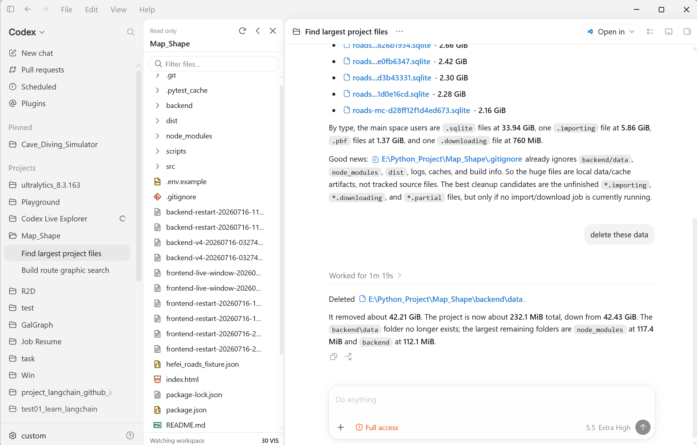

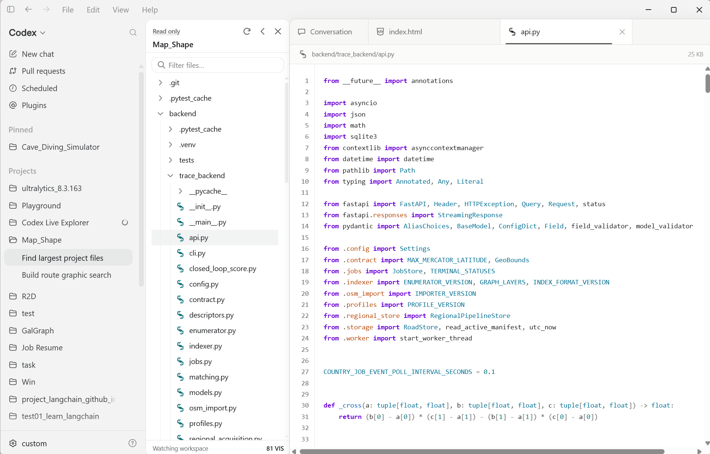

Version **v0.5.21** includes all retained improvements since v0.5.7: ASCII Tiles Background,26 distinct icons with a shared style, persistent per-category pins, ASCII/Custom image/video startup sources and corrected top-menu opacity targeting. Independent plugin versions and exact published URLs preserve matching caches. See the complete [release notes and validation limits](releases/README.md).

A subdued green arrow appears beside the version when an update is available; an up-to-date version has no arrow.


> Local maintenance build v0.5.23 always creates an independent Code-Codex desktop entry alongside takeover of an available original shortcut. Missing managed originals can be repaired, with rollback and uninstall restoration preserved. Includes native startup conflict checks; not publicly released.

## Install Option 1: Download EXE

Download the installer from [GitHub Release v0.5.21](https://github.com/Rice-dog/code-codex/releases/tag/v0.5.21). [`releases`](releases/) retains the corresponding build assets:

Runtime requirement: Windows 10 version 2004 (build 19041) or newer, x64,
with the official stable Codex/ChatGPT Desktop app installed.

- Recommended: `CodeCodex-0.5.21-x64-setup.exe`
- Alternative: `CodeCodex-0.5.21-x64.msi`
- Portable package: `CodeCodex-0.5.21-x64.zip`
- Standalone uninstaller: `Uninstall-CodeCodex.exe`

You can verify downloads with:

```powershell
Get-FileHash .\CodeCodex-0.5.21-x64-setup.exe -Algorithm SHA256
```

Compare the result with [`SHA256SUMS.txt`](releases/SHA256SUMS.txt).

When the official Codex Desktop app is installed, setup checks both the user's
desktop and the shared Public Desktop. It prefers a shortcut to the official
Codex app, and can also adopt a user-created `Codex` or `ChatGPT` shortcut, or
a renamed shortcut pointing to `Codex.exe` or `ChatGPT.exe`. Setup backs up the
original shortcut for uninstall. The local maintenance build always creates a
separate `Code-Codex` desktop entry alongside any original shortcut takeover.
Without an original, the independent entry is used; missing managed originals
can be repaired. The completion dialog shows the primary entry path. Older
public builds create the independent entry only when no original is available.

## Install Option 2: Build EXEs From Source

Requirements:

- Windows 11 x64.
- Rust with the MSVC toolchain.
- Node.js 20.19 or newer.
- Visual Studio Build Tools with Desktop C++.
- .NET SDK if you want to build the MSI package.

Build the release EXE files:

```powershell
./scripts/build.ps1 -Configuration Release
```

The generated EXE files are written to `target/release/`, including:

- `code-codex.exe`
- `code-codex-launcher.exe`
- `Install-CodeCodex.exe`
- `Uninstall-CodeCodex.exe`
- `code-codex-setup.exe`
- `code-codex-shim.exe`
- `code-codex-shortcut.exe`
- `code-codex-uninstall.exe`

Generate the downloadable setup EXE, MSI, and ZIP:

```powershell
./scripts/package.ps1 -Version 0.5.21
```

The generated packages are written to `releases/`.

## Download all plugins on demand

**All 25 Preview Market plugins are separate downloads**: 14 Appearance plugins, 10 File Preview plugins and one Tools plugin. The core retains the file tree, basic text preview and editing, market and settings framework, permission checks and runtime logs. Actual plugin rendering, format viewers, the startup player and tool implementations are no longer embedded.

In Preview Market, click **Download**, then **Enable** after download and verification complete. The current Codex window can use the plugin immediately, without restarting. Downloading does not automatically enable it or open settings. Configuration is available after the complete package is installed; UI Surface Opacity still requires an actually enabled background.

Plugin code and required resources come from this project's GitHub Release. The native loader verifies file size and SHA-256 against the core's embedded catalog before caching and on every load. The market does not accept arbitrary third-party scripts. Packages use three category directories:

```text
releases/plugins/
├── appearance/
│   └── particle-image/       # Main JS, manifest, notices and default images
├── file-preview/
│   └── office-preview/       # Viewer code and local Worker/WASM resources
└── developer-tools/
    └── git-history/          # Read-only Git tool implementation
```

Each folder uses the stable English plugin ID and contains its code, styles and required resources. GitHub Release assets still use unique flat filenames; `releases/release-assets.json` maps them to categorized local paths and SHA-256 values.

Caches are stored at `<installation folder>\plugins\<category>\<plugin ID>\<package version>` after migration; older installations use `%LOCALAPPDATA%\CodeCodex\plugin-cache`. Normal upgrades and ordinary uninstall retain them. Unchanged packages remain available offline; valid old category-free directories or flat caches are verified before migration. Existing parameters, enable preferences, personal images and user videos remain. Installed confirms complete cached files; a package not yet verified and loaded in the current window shows Enable without clearing saved preferences. Previously built-in viewers, tools and the three additional appearance features require their new standalone packages on first use. Existing backgrounds need downloading again only if required package bytes or resources change, are missing or fail verification.

Particle Image includes **six original default images** and Pixel Sculpt includes **three**, downloaded with their background packages. First use imports them without duplicating existing images or replacing personal media and playback choices. Deleted default images stay deleted on reopen. These assets remain outside the core installer.

Codex Startup Transition also requires a downloaded player. The core embeds only a tiny early loader that reads verified startup and selected-background caches during the official loading screen, without network requests or waiting for file-tree mounting. Missing or invalid packages skip the animation, record the reason and let Codex start normally. User videos are persisted in `<installation folder>\data\media\startup`, with IndexedDB retained as a playback cache; neither the installer nor plugin package includes a default official promotional video.

For offline installation, retain the category structure and every required resource, then run that version's `code-codex.exe plugins --import-dir "releases directory"`. A `plugins` directory, category directory or individual plugin directory is also accepted. Only complete assets trusted by the embedded catalog are imported, without automatic activation. There is currently no separate plugin update or uninstall management page.

README screenshots under `docs/screenshots/` remain on GitHub and are excluded from EXE, MSI and ZIP installers. They are documentation images, separate from plugin default libraries; view the repository README for complete screenshots. Setup does not download all plugins automatically. Locally built packages need matching GitHub assets published before Download works for other users.

### Upgrade notes

EXE/ZIP users can update the existing installation without uninstalling; settings, original media and verified matching plugin caches are retained. An MSI-owned installation cannot be overwritten by the standalone EXE downloaded by the online updater; use the MSI/Windows Installer path. If the official session has no verified debugging listener, installation is retained and reopening through the Code-Codex launcher is required; the current chat is not closed automatically. A broken older menu can be bypassed by downloading the complete EXE installer manually. Every historical direct-upgrade and real MSI-upgrade combination has not been tested.

## Uninstall

Removal uses the same branded wizard as installation: confirm, remove, then Finish.

Every install path includes a source-built uninstaller program:

- Downloaded setup/ZIP installs place `Uninstall-CodeCodex.exe` under
  `%LOCALAPPDATA%\Programs\Code-Codex`.
- Source builds place `Uninstall-CodeCodex.exe`,
  `Uninstall-CodeCodex.ps1`, and `Finalize-Uninstall.ps1` in `target/release/`.

Run `Uninstall-CodeCodex.exe` to restore the original desktop shortcut and
remove Code-Codex files. The local maintenance build also removes its managed
standalone `Code-Codex` desktop entry. User replacements are neither overwritten
nor deleted; conflicts retain recovery state.
MSI installs can also be removed from Windows **Installed apps**.

## Features

### Core Features

- A Code-Codex menu beside Help in the Codex top bar shows or hides the file tree, opens Preview Market, checks for updates, and opens the project's GitHub repository.
- File tree in the Codex sidebar for local workspaces.
- Drag files and folders from Windows File Explorer into the workspace root or a file-tree folder.
- Context menu actions for create, rename, delete, copy path, reveal, and refresh.
- Drag-and-drop movement for workspace files and folders.
- Main-window file tabs beside the conversation.
- Basic text preview, syntax highlighting and bounded editing; Markdown rendering is provided by its standalone viewer plugin.
- Source previews and editors include a syntax-colored minimap, click/drag/wheel/keyboard navigation and a saved toggle. Narrow panes hide it automatically. It sits to the left of the single far-right scrollbar; its viewport rectangle appears during hover or scrolling.
- A local bridge restricted to bounded workspace operations.

### Global language and Custom Background

Welcome preselects Chinese or English from the system language. After installation, use Code-Codex → Language to switch. Plugin names remain English; parameters and normal UI follow the global setting. Technical errors and diagnostics remain English. Custom Background imports local images/videos and provides per-media transforms, appearance controls and Reset. It works with UI Surface Opacity, keeps the settings video preview synchronized and avoids reloading the background when opening settings.

### Plugins

- Preview Market groups plugins into Appearance, File Preview, and Tools, and opens on Appearance by default.
- File Preview independently downloads and enables Markdown, CSV, diagram, image, video, PDF, audio, Jupyter Notebook, Office, and 3D model previews, with all processing performed locally.
- Appearance includes ten dynamic backgrounds, Transparent Background, UI Surface Opacity and Codex Startup Transition, each downloaded before activation.
- Once downloaded and enabled, Git History under Tools shows the current branch, commits, changed files, and colored per-file diffs in read-only mode without repository write operations.

### Updates and Compatibility

- Click the version number at the bottom of the file tree or choose **Check for Updates…** from the Code-Codex menu to check GitHub for the latest published stable release.
- Codex Startup Transition supports video or any of the ten dynamic backgrounds, including Particle Image and Pixel Sculpt with their local image libraries. Backgrounds display for at least four seconds, then fade after Codex is ready.
- Startup failures show the exact failing stage, a stable support code, a suggested action, and buttons to copy or open a redacted local diagnostic report.
- Codex package versions are diagnostic only; future versions proceed through live protocol and DOM qualification instead of a fixed version allowlist.

## Preview Market Plugins

Preview Market is located at the bottom of the Code-Codex file tree. It groups plugins into
**Appearance**, **File Preview**, and **Tools**, shows one category at a time, and opens on
Appearance by default.

### File Preview Plugins

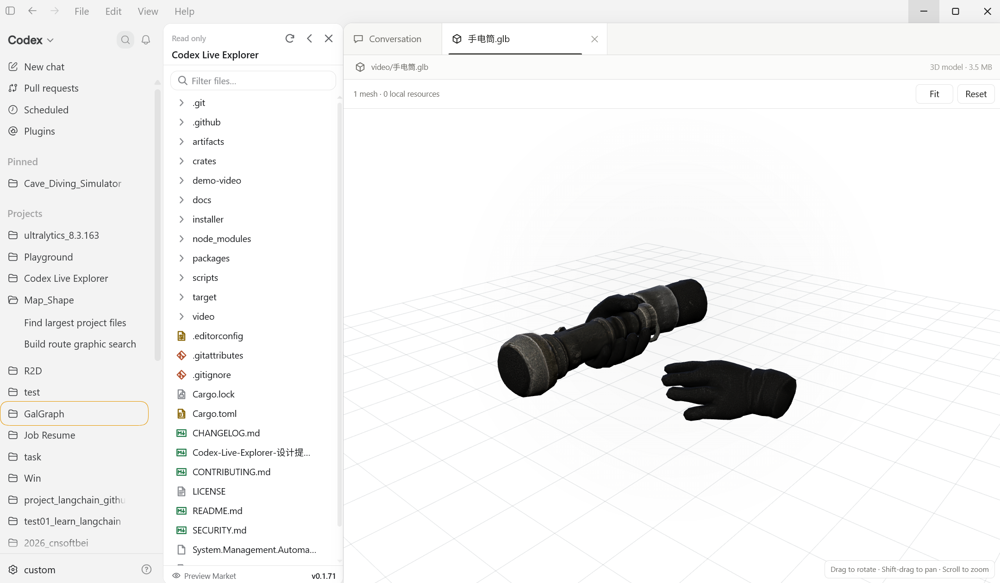

File Preview can independently download and enable Markdown, CSV, diagram, image, video, PDF, audio,
Jupyter Notebook, Office document, and glTF 3D model previews. All preview processing runs
locally on the user's computer.

The 3D Model Preview plugin provides an interactive view for `.gltf` and `.glb`
files with orbit, pan, zoom, fit/reset, reference-grid, and animation controls.

### Appearance Plugins

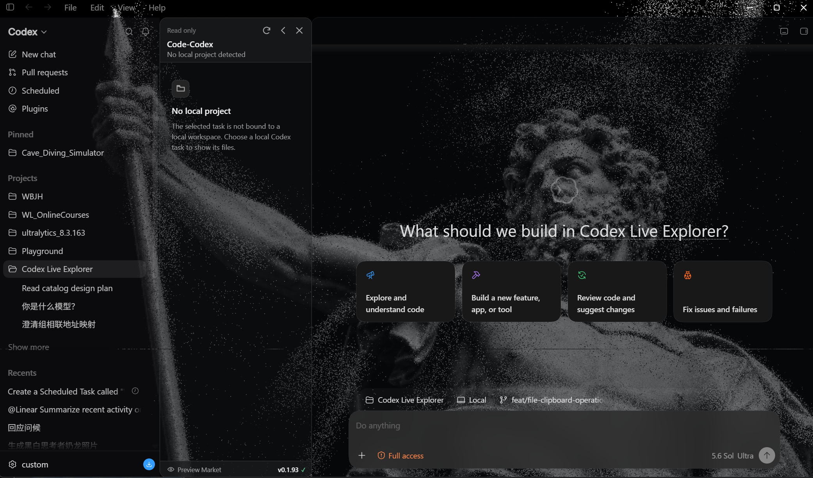

The Particle Image Background appearance plugin transforms locally selected
images into an animated grayscale particle field across Codex. Its image
library supports ordered auto-switching, smooth morphing, per-photo position
and zoom, direct numeric values, and adjustable flow, pointer, source, and
render settings. Transparent Background is available separately. Particle
images and settings remain local to the user's Codex profile. The gathering
opening has enable, duration, spread, and replay controls; the normal background
replays its opening after the startup overlay exits.

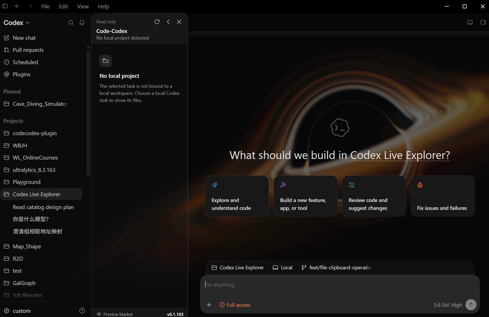

The Black Hole Background appearance plugin reuses the same full-window
background surface and adds an adjustable ray-marched black hole with temporal
accumulation and bloom. Its renderer quality values are fixed internally for a
consistent experience and are intentionally hidden from users. Enabling it
switches the real Codex Appearance setting to Dark; disabling it restores the
user's previous Appearance setting.

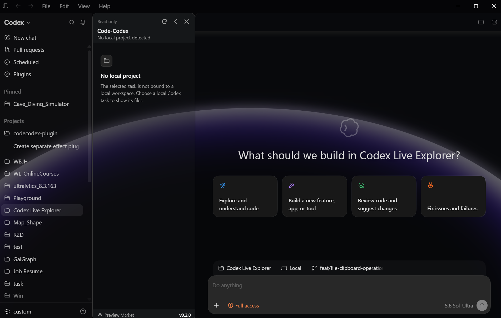

The Glow Horizon Background appearance plugin adds an interactive luminous
horizon across the full Codex window. It supports top, bottom, left, and right
directions, wheel-driven deformation, inertia and return controls, opening
animation settings, customizable glow colors, and Chinese/English labels.
Enabling it switches Codex to Dark appearance and disabling it restores the
previous appearance setting.

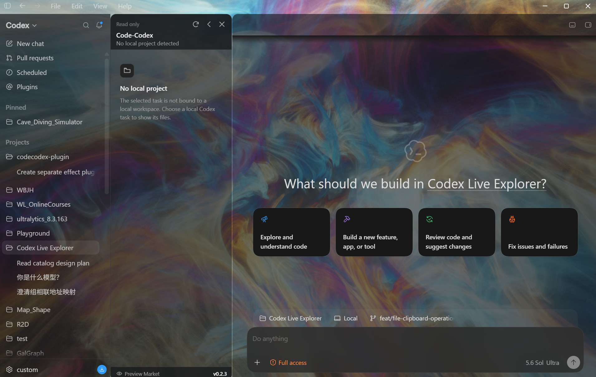

The Heavenly Cloud Background appearance plugin adds a textureless,
ray-marched celestial cloud tunnel across the full Codex window. It provides
adjustable drift, light density, turbulence, tunnel radius, spectral shift,
pointer steering, opening animation, and three render-quality levels. Its
settings panel supports Chinese and English, and it uses the same automatic
Dark appearance and restoration behavior as the other GPU backgrounds.

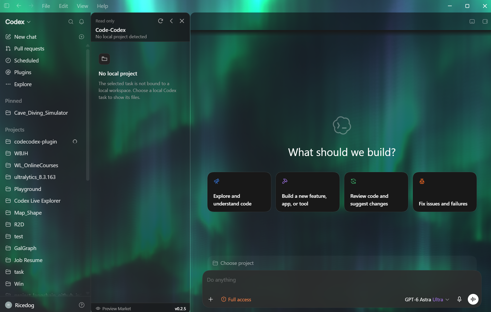

The Aurora Ionosphere Background appearance plugin adds runtime-generated
volumetric aurora curtains and a procedural star field across the full Codex
window. It preserves the source effect's three-pass WebGL pipeline, adaptive
quality, and cinematic reveal while exposing bilingual controls for the ion
field, opening sequence, quality, and animation state.

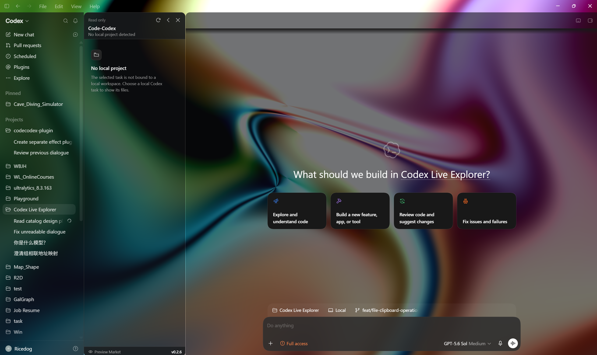

The Milky Way Background appearance plugin fills the Codex window with five-color
harmonic light. Its bilingual settings panel provides individual colors, flow
speed, amplitude, frequency, scale, rotation, brightness, and opening controls.
It uses one WebGL pass, pauses rendering while hidden, and supports pause, replay,
and reduced motion. Like the other GPU backgrounds, it activates Dark appearance
and restores the previous preference when disabled. The supplied effect project
reconstructs a partial reference to “Milky way” by Almina (@Code4_11).

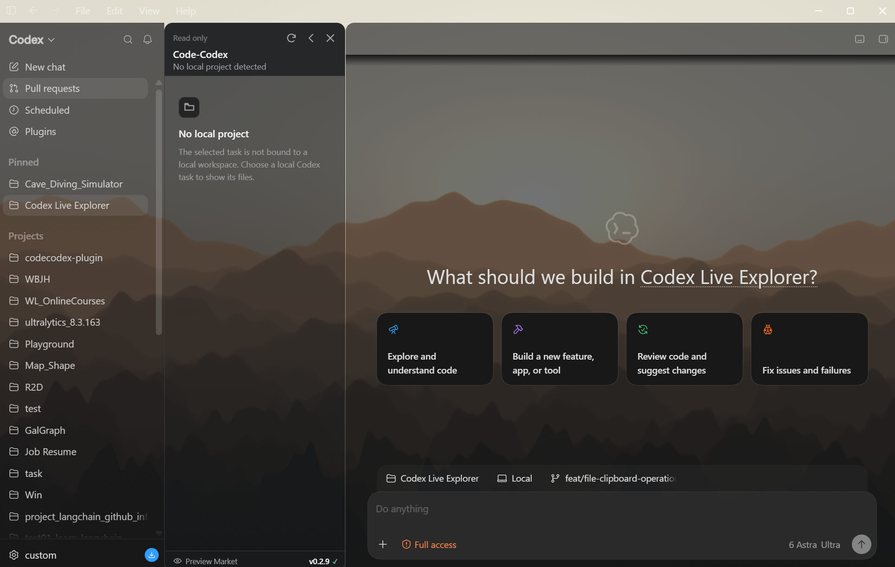

Layered Mountain Background adds animated atmospheric ridges, warm backlight, mist, and depth across the Codex window, with bilingual controls for reverse drift, mountain shape, exposure, render scale, quality, pause, and reset; its gentle three-second opening reveals the ridges from back to front, supports replay, and is skipped under reduced motion; the plugin uses a two-pass WebGL 2 renderer with a compact ridge atlas and automatically restores the previous appearance after its native Dark mode is disabled.

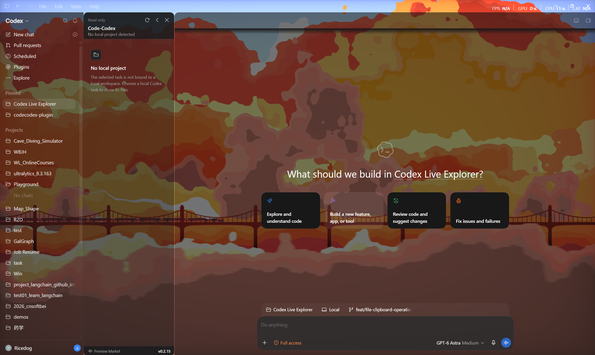

Cloud Train Background renders clouds, a steam train, and a bridge across Codex, with bilingual controls for speed, zoom, cloud detail, feedback, hue, temperature, independent sky/smoke/train tints, pause, and reset; its staggered in-place opening fades layers from back to front without vertical movement and provides an enable switch, a 0.5–10 second duration, feather width, and replay, defaulting to three seconds and skipping under reduced motion; enabling the plugin uses the native Dark appearance and disabling it restores the previous setting.

#### Pixel Sculpt Background

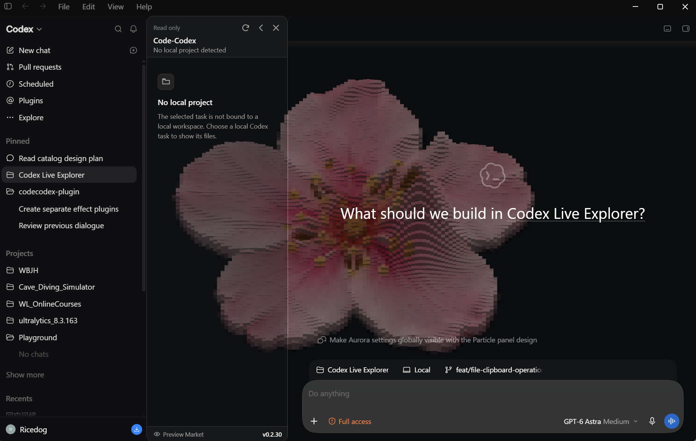

Enable Pixel Sculpt Background in Preview Market to transform images into an interactive 3D pixel-relief background. Its bilingual secondary settings panel controls tile shape, relief depth, pointer ripples, color, position, and rotation, with a local image library, playback ordering, and automatic morph transitions. Enabling the plugin switches Codex to its native Dark appearance; disabling it restores the previous setting.

#### Blinking Squares Background

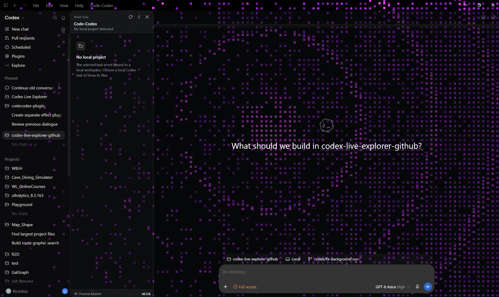

Blinking Squares Background fills the Codex window with independently twinkling squares that become denser toward a selected edge. Its bilingual settings panel controls direction, density, color, mouse trails, click pulses, and random keyboard waves, including their concurrent limit and cooldown. It also supports opening animation, pause, replay, and render-quality controls. Enabling the plugin switches Codex to Dark appearance; disabling it restores the previous setting.

### Tool Plugins

Git History is available under Tools and shows the current branch and commit history in read-only
mode. Open a commit to inspect its changed files, then select a filename to open a diff tab in the
main conversation area with green additions, red deletions, and purple hunk-location metadata.

## Repository Layout

```text
crates/
  cdp-client/          Chrome DevTools Protocol client
  context-resolver/    Codex task/workspace context resolution
  launcher/            Windows launcher and Codex integration logic
  workspace-service/   File listing, preview, mutation, settings, and watcher code

packages/
  explorer-ui/         Injected TypeScript explorer UI

installer/src/         Installer/uninstaller source templates and shared fragments
resources/             Bridge, language domains, plugin definitions/distribution lock, managed assets
scripts/               Build and packaging helper scripts
releases/              Ready-made downloadable packages
```

## Notes

Generated build folders such as `target/`, `node_modules/`, `dist/`, and
`artifacts/` are intentionally ignored by Git. Rust tests, browser/PowerShell fixtures in `scripts/`, and public contract checks in `.github/workflows/architecture.yml` are included. Native windows, the official desktop client, and Office capabilities require separate verification on an appropriate machine.

## License

[MIT](LICENSE). See the [third-party notices](THIRD_PARTY_NOTICES_EN.md) for effect provenance, Code-Codex modifications, and license boundaries.

## Centralized storage

The EXE uses a compact 720 logical-pixel client-width, 3:1.8 overall aspect-ratio white branded wizard, with native monitor-DPI text and controls and aspect-preserving branding: Welcome → License Agreement → Installation Folder → Installing → Finish. Read and accept the MIT License before choosing a folder. Check Custom installation to reveal the folder field, then click Install; the same window shows progress and stays on the completion page until Finish is clicked. The default is `%LOCALAPPDATA%\Programs\Code-Codex`; a dedicated folder on another fixed local drive is supported. Updates reuse the installed location; in-app updates from this version or later show Installing → Finish in the same branded window, skipping Welcome, License and Folder selection. The public v0.4.4 updater uses the full wizard for its first upgrade to this version and retains the original folder; this is the expected compatibility flow, but an actual upgrade from that old release has not been tested. To relocate, uninstall while retaining data, then install into a new folder; retained data is copied and the original is kept for recovery. For MSI use `msiexec /i CodeCodex-0.5.21-x64.msi INSTALLFOLDER="D:\Apps\Code-Codex"`.

Program versions live in `versions/`, integration state in `integration/`, preferences and personal images/videos in `data/`, verified downloadable plugins in `plugins/<category>/<id>/<version>/`, diagnostic and runtime reports in `logs/`, update temporary files in `temp/`, and migration records in `backups/`. Only a small location pointer lives in the current-user registry. Official Codex accounts, chats and workspace files are outside this storage contract. Browser storage remains a rendering cache; Code-Codex preferences and personal media have native persistence.

Runtime retention remains ten runs with a 5 MiB bound per run; installer reports retain ten files. Update events currently appear primarily in runtime logs. Initial extraction and emergency fallback may use the system temporary folder. Normal uninstall retains user data; explicit purge deletes only known product data paths and preserves unrelated files in the selected folder. Network paths, system folders, drive roots and linked ancestors are rejected. Unchanged downloadable plugin assets remain pinned to public v0.3.96.

After a successful EXE installation, the current and actual previous versions are retained; eligible older versions are safely removed. Running, locked, unverifiable or unrecognized entries remain, with reasons in the installation log's versionRetention field. Sessions are not terminated to reclaim space. MSI continues to use Windows Installer version management.


UI composition lives in `packages/explorer-ui/src/app/`; `contracts/`, `core/`, `features/`, `plugin-host/`, and `components/` own types, lifecycle primitives, domain controllers, plugin capabilities, and shared presentation. Root compatibility exports should not accumulate new behavior. Plugin definitions and the immutable distribution lock preserve independent package versions/tags across application upgrades; changed plugin bytes require explicit rebuild and identity review.

Run `node scripts/check-architecture.mjs`, `node --test scripts/test-refactor-contracts.mjs scripts/test-plugin-publication.mjs`, and `cargo test --workspace --locked`. Installer workers are generated from source templates; check them with `node scripts/generate-installer.mjs` and `scripts/check-worker-protocol.ps1`.

Startup plugin sources now include ASCII Tiles Background and Custom Background, reading the selected custom image/video and its parameters without changing normal backgrounds. Market cards support persistent per-category pins in click order. Pin glyphs use50% opacity. Exact updated assets are published at their catalog tags.
